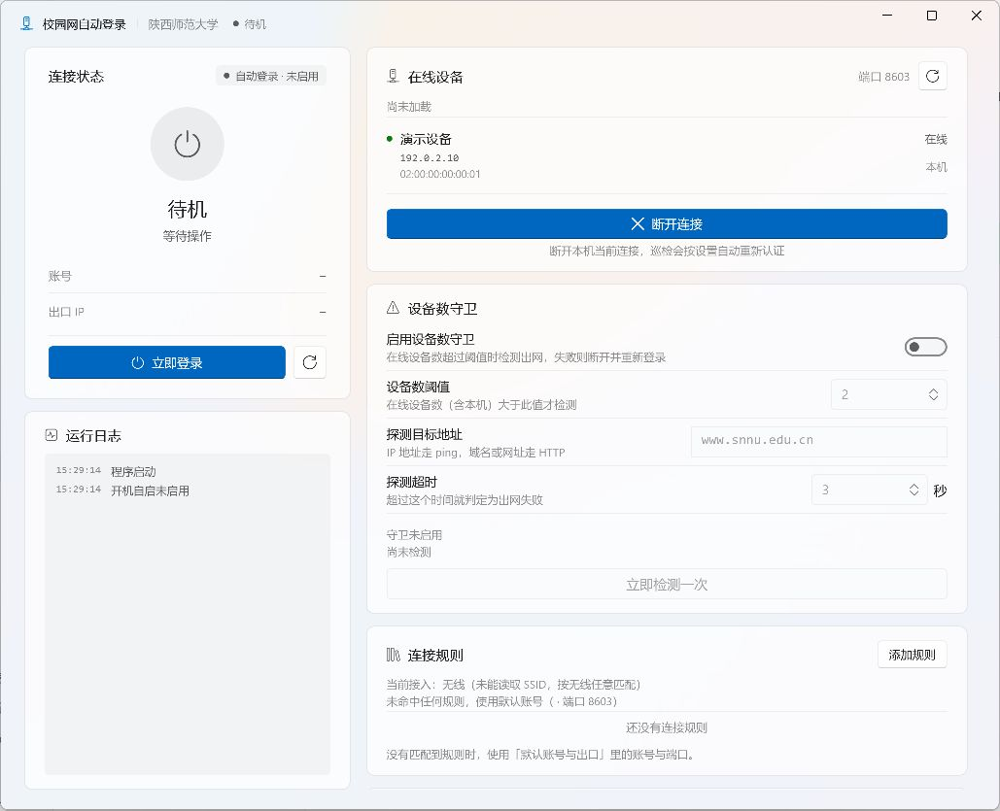

<p align="center">
  
</p>

# SNNUAutoLogin-GUI

陕师大校园网自动登录客户端。可以在 Windows 托盘后台运行，支持断线重连，也可以按宿舍 Wi-Fi、其他无线网络和有线网络分别配置账号。另有 Linux 桌面与命令行预览版。

<p>
  
  
  
  
  <a href="https://github.com/mzh2077/SNNUAutoLogin-GUI/releases/latest"></a>
</p>

[Windows 下载](https://github.com/mzh2077/SNNUAutoLogin-GUI/releases/latest) · [Linux 预览版](https://github.com/mzh2077/SNNUAutoLogin-GUI/releases/tag/linux-1.6.0) · [反馈问题](https://github.com/mzh2077/SNNUAutoLogin-GUI/issues)



## 安装与登录

Windows 版支持 Windows 10 2004 及以上和 Windows 11（x64）。安装版下载文件名以 `Setup-<版本>.exe` 结尾的安装包，双击安装。1.6.1 提供单文件便携版，下载带 `Portable` 的 EXE 即可运行。较早版本的 ZIP 便携包需要完整解压。安装版可以覆盖升级，卸载时会清理本地配置和凭据。

1. 先连接校园网，再打开客户端。
2. 在「默认账号与出口」填写学号和密码，选择校园网直连或实际使用的运营商。
3. 点击「立即登录」。如果门户要求图形验证码，在窗口中输入后继续。
4. 按需打开「开机自动登录」「断线自动重连」和「关闭时驻留托盘」。想结束后台运行，可从托盘菜单退出。

## 连接规则和设备数守卫

- **连接规则**可按有线、任意 Wi-Fi 或指定 Wi-Fi 名称选择账号和运营商。无线网络优先匹配指定名称，没命中规则时用默认账号。
- **在线设备**列出当前账号的会话。可下线其他设备，也可断开本机。开启自动重连后，本机断开后可能再次登录。
- **设备数守卫**默认关闭。在线设备超过设定阈值后，才会检查指定目标的连通性。探测失败时，守卫会尝试断开本机并重新认证。

### 浏览器能上网，守卫为什么仍显示异常？

先在守卫卡片点「立即检测一次」，再到「在线设备」点刷新。前者只测目标地址，后者查询校园网门户。如果探测通过但列表读取失败，守卫会跳过本轮。域名或网址走 HTTP(S) 直连，收到 2xx 才算通过。纯 IP 地址走 ping。两种探测都受配置中的超时限制。

## Linux 预览版

Linux 1.6.0 面向 Ubuntu 24.04 和 Debian 13（x64）。桌面和命令行共用后台服务。安装桌面 `.deb` 前，先安装同版本的命令行与服务包，也可以下载同时包含两种入口的便携包。登录后自启需要自行启用。 [Linux 安装与命令说明](https://github.com/mzh2077/SNNUAutoLogin-GUI/blob/main/Linux/README.md)

## 本地数据与排障

Windows 设置保存在 `%LOCALAPPDATA%\SNNUAutoLogin`，密码使用当前 Windows 用户的 DPAPI 加密。Linux 可把密码保存到系统密钥环，或仅在后台进程运行期间使用。

Windows 上可运行 `SNNUAutoLogin.exe --diag`，结果在 `%TEMP%\snnu_diag.txt`。反馈时请附上客户端版本、系统版本、网络接入方式和复现步骤，分享日志前遮盖学号、IP 和 MAC 地址。

## 构建与测试

Windows 使用 .NET 8 SDK。从仓库根目录执行：

```powershell
dotnet build SNNUAutoLogin.csproj -c Release -p:Platform=x64
dotnet run --project tests/StartupTests -c Release
dotnet run --project tests/CredentialTests -c Release
dotnet run --project tests/DeviceListTests -c Release
dotnet run --project tests/GuardTests -c Release
```

安装 Inno Setup 6 后运行 `./tools/build_release.ps1` 可生成 Windows 安装版和 ZIP 便携版。Linux 使用 .NET 10 SDK，构建和打包步骤见 [Linux 开发说明](https://github.com/mzh2077/SNNUAutoLogin-GUI/blob/main/Linux/README.md)。

本项目为非官方客户端。请在自己的设备上使用，并遵守学校的网络使用规定。 [贡献者](https://github.com/mzh2077/SNNUAutoLogin-GUI/graphs/contributors)
