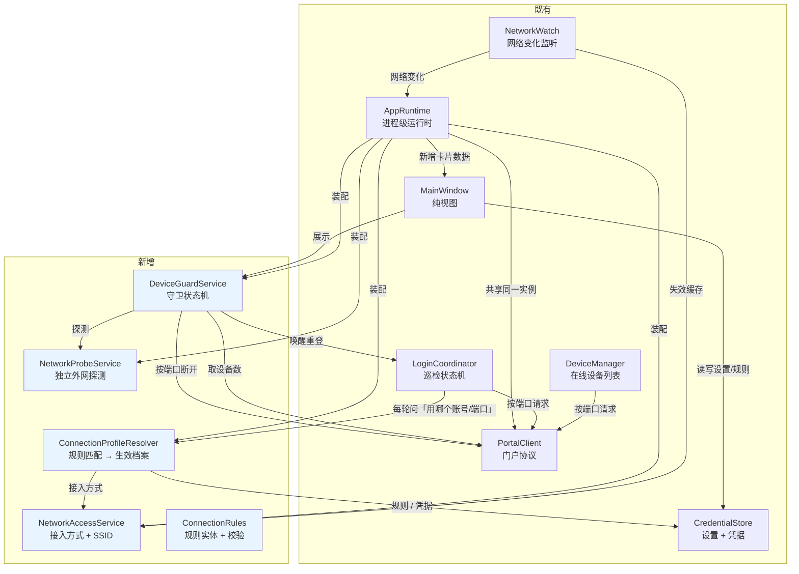
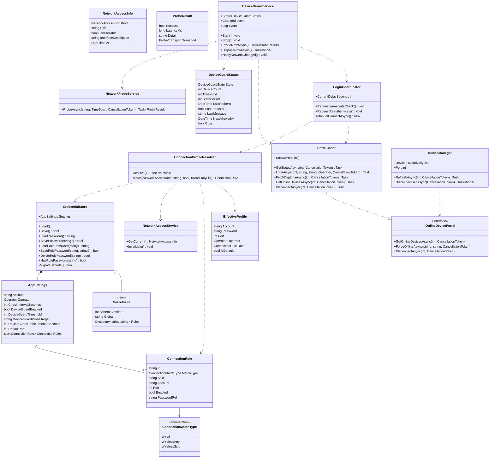
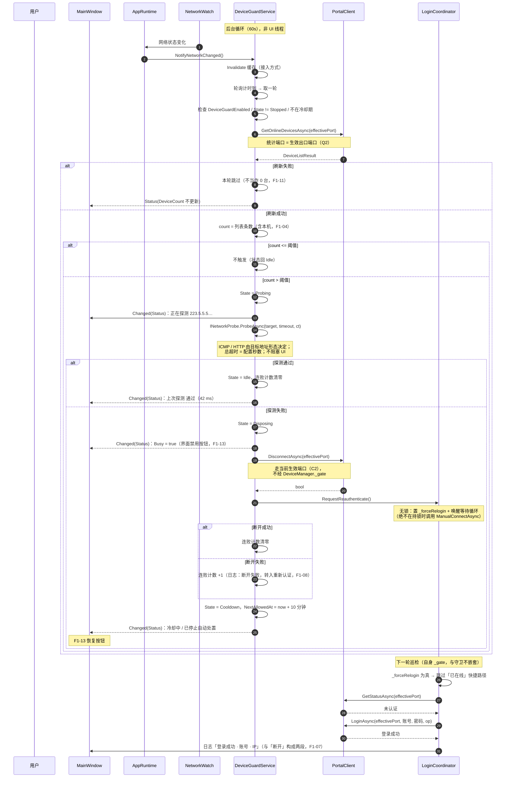
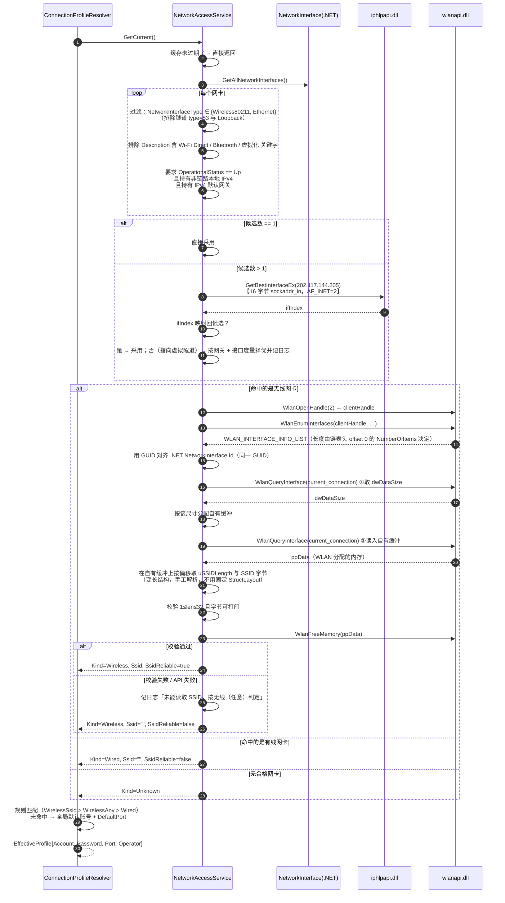
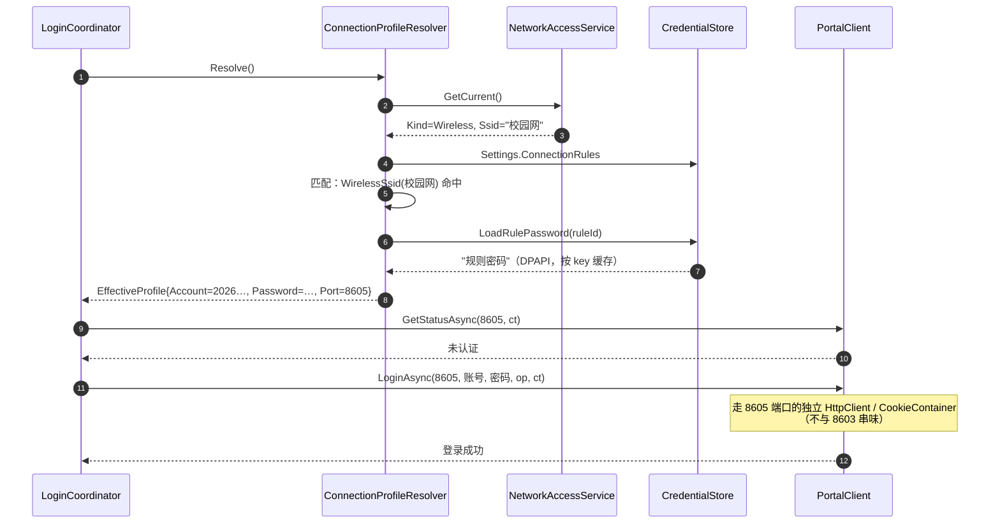
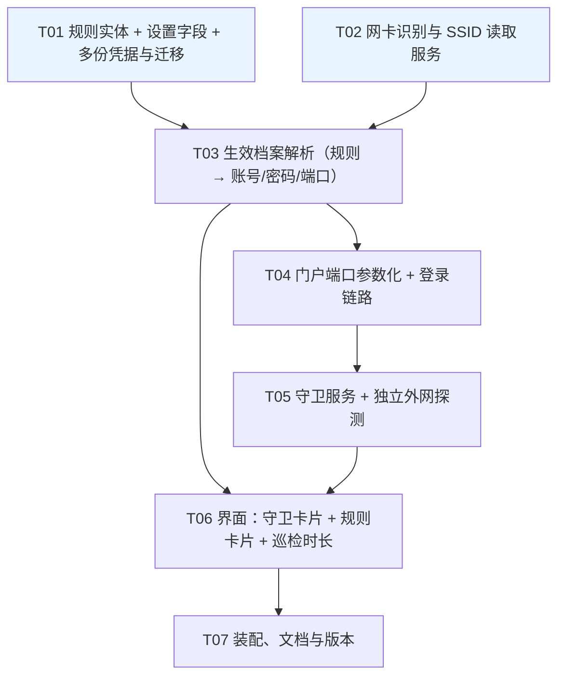

# 架构设计：设备数守卫 · 自定义巡检时长 · 按连接方式区分账号与出口

| 项目 | 内容 |
| --- | --- |
| 项目名 | `device_guard_profiles` |
| 产品 | SNNUAutoLogin-GUI（陕西师范大学校园网自动认证客户端 · WinUI 3 桌面应用） |
| 形态 | 增量开发，基于 `feature/device-guard-profiles`（已含 `feature/online-device-management`） |
| 上游文档 | `docs/prd-device-guard-profiles.md`（增量 PRD，含数据模型草案 §5） |
| 文档类型 | 系统架构设计 + 任务分解（**只设计，不含实现代码**） |
| 语言 | 简体中文（界面文案一律中文） |
| 消费方 | 架构师（本文档）→ 开发 → 测试 |

---

## 0. 关键前置：架构设计所依赖的本机实测结论

以下结论全部在本机 `C:/Users/marik/WorkBuddy/2026-11-10-13-40-27/repo`（分支 `feature/device-guard-profiles`）实测得到，**直接决定了后文的技术选型**，与 PRD 的假设有若干出入之处，工程师请以本节为准。

| # | 实测结论 | 证据 | 对设计的影响 |
| --- | --- | --- | --- |
| E1 | `System.Net.NetworkInformation.NetworkInterface` **没有 `PhysicalMediaType` 属性** | `CS1061: “NetworkInterface”未包含“PhysicalMediaType”的定义` | 过滤「虚拟隧道 / 蓝牙 / Loopback」**不能**用 `PhysicalMediaType`，必须改用 `NetworkInterfaceType` + `Description` + `OperationalStatus` + IPv4 地址白名单 |
| E2 | 本机存在一个 **`Up` 状态的虚拟隧道网卡**（`Meta` / Meta Tunnel），`NetworkInterfaceType = 53`（非 `Ethernet` 非 `Wireless80211`），且**持有默认路由**（`0.0.0.0/0`，RouteMetric 0） | `Get-NetRoute`、`Get-NetIPInterface` | 「`OperationalStatus.Up` 就是有效网卡」的朴素做法**会误判**；而它有默认路由 ⇒ 路由表类判据也会被它带偏 |
| E3 | `GetBestInterfaceEx` 必须传 **16 字节 `sockaddr_in`**（`AF_INET=2` 放前两字节，地址放 offset 4）；传 4 字节原始地址会返回 `err=87 ERROR_INVALID_PARAMETER` | 两种传法对比实测 | P/Invoke 封送细节必须写死，否则线上静默失败 |
| E4 | 本机 `GetBestInterfaceEx(202.117.144.205)` / `GetBestRoute` **对所有目的地都返回 ifIndex=37（Meta 隧道）**；`UdpClient.Connect` 探测到的本地源地址同样是 `198.18.0.1`（Meta） | 实测 | **不能用「路由表里最优先的那块网卡」当「接入方式」判据**，否则会把虚拟隧道当成有效接入 |
| E5 | `.NET CookieContainer` **不按端口隔离 Cookie** | 本机 `HttpListener` 双端口实验：18601 上种的 `NASID` 被发往 18602 | 门户多端口必须**按端口隔离 Cookie**，否则「A 端口的账号」会污染「B 端口的账号」→ F3 多规则账号直接串味 |
| E6 | `WlanOpenHandle(2)` 成功；`WlanEnumInterfaces` 返回的 `WLAN_INTERFACE_INFO_LIST` **头部的 `NumberOfItems` 正确（=1），但出参 `pdwNumberOfItems` 读回为 0** | 实测两次，均复现 | 条数必须**从链表头 offset 0 读**，不能信出参 |
| E7 | `WlanEnumInterfaces` 返回的接口 GUID（`c2cde55a-…`）与 `.NET NetworkInterface.Id`（`{C2CDE55A-…}`）**是同一个 GUID** | 实测对比 | **SSID ↔ 网卡映射不需要 `IP_ADAPTER_ADDRESSES.AdapterName`**，直接用 GUID 对齐即可 |
| E8 | `WlanEnumInterfaces` 只列出了 1 个真实 Wi-Fi 接口（AX201），**不含** 2 个「Microsoft Wi-Fi Direct Virtual Adapter」 | 实测 | WLAN GUID 集合天然排除虚拟无线适配器，比字符串匹配可靠 |
| E9 | ~~`WlanQueryInterface(current_connection)` 返回 772 字节缓冲但解不出 SSID~~ **该结论已被 E13/E14 推翻**：真正的原因是 **opcode 与偏移都取错了**，不是 WLAN 实现受限 | 见 E13 / E14 | SSID 取不到时**不要**先归因于「系统实现受限」，要先把 opcode 与结构偏移坐实 |
| E10 | `System.Net.NetworkInformation.Ping` 在 .NET 8 **没有带 `CancellationToken` 的 `SendPingAsync` 重载** | 反射枚举全部重载 | 超时必须靠「超时参数 + `Task.WhenAny` + 取消令牌」实现，不能指望 CT 直接中断 |
| E11 | `Ping` 223.5.5.5 实测 `Success`，RTT 43–59 ms | 实测 | ICMP 探测可行；默认目标 `223.5.5.5` 合理 |
| E12 | 本机 `wlanapi.dll` / `iphlpapi.dll` 存在，`WlanSvc`（Automatic / Running）、`AppIDSvc`（Running）正常 | 实测 | P/Invoke 走系统自带 DLL，无需第三方包 |
| **E13** | **`wlan_intf_opcode_current_connection` 的值是 `7`，不是 `4`**。实测：`opcode=4` 返回 **772 字节**且 `outOpcode=2`（这是 `radio_state` 的形状，缓冲里根本没有 SSID）；`opcode=7` 返回 **604 字节**且 `outOpcode=0` | `--wlan` 探针逐 opcode 打印 size/outOpcode/十六进制 | **取 SSID 的 opcode 必须是 7**。`4` 是 `wlan_intf_opcode_radio_state`，取错了必然解不出 SSID，而且失败方式非常隐蔽（不报错，只是"取不到"） |
| **E14** | **`DOT11_SSID.uSSIDLength` 在 `WLAN_CONNECTION_ATTRIBUTES` 缓冲里的偏移是 `520`，不是 `8`**。实测 `opcode=7` 的缓冲：`offset 8` 起是 UTF-16 的 `profileName`（`6D-00-74-00-74-00…` = "mtt"），`offset 520` 处 `len=10`，`offset 524` 起是 ASCII `"mtt_315_5G"` | `--wlan` 探针扫描全部 `uSSIDLength` 候选位置 | 结构是 `isState(4) \| mode(4) \| profileName[256]WCHAR(512) \| association{ DOT11_SSID{ uSSIDLength(4), ucSSID[1..32] } }`。**offset 8 是 profileName 的头，不是长度字段** —— 按长度读会得到 109（`0x6D`），被 `1..32` 的校验直接挡掉，于是表现为"永远取不到 SSID" |
| **E15** | `WlanQueryInterface` 的 `ppData` 是 **out 参数**：WLAN 服务总会自己分配并填充，**传 `NULL` 只是说"不要把指针给我"**。单次调用即可同时拿到 `dwDataSize` 与内容 | `--wlan` 探针对比 | 「先问长度再取数据」跑两遍的写法**会漏掉第一次分配的内存**（`WlanFreeMemory` 只释放最后一个指针）。正确做法：**调用一次**，读 `size` 与 `data`，一次 `WlanFreeMemory` |

> **给工程师的验证提示（2026-11-10 实测更新）**：本机启用了 **Smart App Control**（`VerifiedAndReputablePolicyState=1`），策略里带 `VerifiedAndReputableAllowUnknown` / `VerifiedAndReputableAllowAntiMalware`，**不含任何路径规则**。实际效果是：**同一路径下已跑过的文件能再跑，改了代码重编的新 dll 首次运行会被拦**（报 `0x800711C7` 应用程序控制策略已阻止此文件）。`dotnet build` 永远成功，只有「运行新产物」会被拦。
>
> **当前实测可用的绕过通道**：`tests/<某工程>` 的 csproj 里内置了 `WdacSlot` 开关，把产物**借用 `StartupTests` 的路径 + 文件名**即可在本机执行：
> ```bash
> dotnet build tests/XxxTests -c Release -p:WdacSlot=StartupTests
> dotnet tests/StartupTests/bin/Release/net8.0-windows/StartupTests.dll
> # 跑完务必重新构建 StartupTests 把产物还原回去
> dotnet build tests/StartupTests/StartupTests.csproj -c Release
> ```
> 主程序本体没有等价通道（它是 WinUI 3 + apphost，apphost 会按自身名字去找同名 dll），因此**主程序的实机验证走 `tests/LiveCheck`**（同样借用该槽位），而不是直接跑主 exe。


---

## 1. 方案总览

### 1.1 一句话方案

新增三个**可单测的纯逻辑/可注入服务**（`NetworkAccessService` 判接入方式、`ConnectionProfileResolver` 解析生效账号、`DeviceGuardService` 守卫状态机 + `NetworkProbeService` 独立外网探测），把 `PortalClient` 改成**按端口参数化 + 按端口隔离 Cookie**，`CredentialStore` 扩成**多份 DPAPI 凭据 + 兼容迁移**，`LoginCoordinator` 改为**每次巡检先解析生效档案（账号/密码/端口）再发起登录**；界面新增「设备数守卫」「连接规则」两张卡片并把巡检时长改成 `NumberBox`。

### 1.2 组件关系图



### 1.3 三条硬约束的落点

| 约束 | 落点 |
| --- | --- |
| **C1 登录必须可指定端口** | `PortalClient` 全部登录相关方法加 `int port` 首参；`LoginCoordinator` 每轮从 `ConnectionProfileResolver.Resolve()` 取生效端口 |
| **C2 断开路径必须可指定端口** | 守卫调用 `IOnlineDevicePortal.DisconnectAsync(effectivePort)`；**不复用** `DeviceManager.DisconnectSelfAsync()`（它用 `DeviceManager.Port` 成员，B9/B10） |
| **C3 老凭据不能丢** | `CredentialStore` 增 `secrets.json`（`SchemaVersion`/`Global`/`Rules`），按迁移契约 M1–M7 从 `secret.bin` 幂等迁移；`secret.bin` **永不删除**且继续双写，保证降级可用（A3） |

---

## 2. 技术选型

> 每项格式：**选定 / 备选 / 理由**。

### 2.1 「当前接入方式」判定（PRD F3-05、Q1）

| 项 | 内容 |
| --- | --- |
| **选定** | **两层判定**：<br>① **候选集**：`.NET NetworkInterface.GetAllNetworkInterfaces()` → 过滤 `NetworkInterfaceType ∈ {Wireless80211(71), Ethernet(6)}`（**这自动排除了 E2 的隧道 type=53 与 Loopback**）→ 再排除 `Description` 含 `Wi-Fi Direct` / `Bluetooth` / `Hyper-V` / `VMware` / `VirtualBox` / `Tunnel` / `Loopback` 的虚拟适配器 → 再要求 `OperationalStatus == Up` 且持有**非链路本地**的 IPv4（排除 `169.254.x.x` / `127.x` / `::1`）→ 再要求持有 IPv4 **默认网关**。<br>② **唯一候选直接采用**；**多候选时**用 `GetBestInterfaceEx(202.117.144.205)`（E3 的 16 字节 `sockaddr_in`）取 ifIndex → 映射回候选集；若返回的是隧道（不在候选集，E4）→ 降级为「按 IPv4 接口度量 `InterfaceMetric` 最小者 + 有默认网关者」择优，并在日志写明「路由指向虚拟网卡，已按物理网卡判定」。 |
| **备选 A** | `GetAdaptersAddresses` 读 `IP_ADAPTER_ADDRESSES.PhysicalMediaType`（`NdisPhysicalMediumNative802_11=1` / `802_3=14` / `Unspecified=0`）——**判据最权威**，但结构体巨大且含变长尾部，`IP_ADAPTER_ADDRESSES.AdapterName` 是 `{GUID}` 字符串需与 WLAN GUID 对齐（E7 已证明可行）。 |
| **备选 B** | 纯 `GetIfTable2`（`MIB_IF_ROW2`）——扁平结构，含 `InterfaceIndex` / `InterfaceGuid` / `Description` / `Type` / `MediaType` / `PhysicalMedium` / `OperStatus`。**本机实测该结构体封送崩溃（`AccessViolationException`），字段偏移不可靠，暂不采用。** |
| **备选 C** | 「`OperationalStatus.Up` 且 `NetworkInterfaceType ∈ {Wireless80211, Ethernet}`」的朴素做法——**已被 E2 否决**（隧道网卡会是 `Up`）。 |
| **理由** | ① PRD F3-05 要的是「当前生效（默认路由所用）网卡」，但 **E4 证明本机默认路由被虚拟隧道占据**，纯路由判据会把隧道当接入方式；因此判据必须是「**物理网卡 + 有网关 + 有真实 IPv4**」，再用路由表做**择优提示**而非唯一判据。<br>② 备选 A/B 判据更权威但封送复杂、无法在本机验证（A、B 实测失败），一旦字段错位就是线上静默错误 —— 与本仓库「先跑通再优化」的既有风格不符。<br>③ 备选 C 实现最简但已被 E2 证伪。<br>④ 全部逻辑抽在 `INetworkAccessService` 后面，可用 Fake 替身覆盖全部判定分支（可单测）。 |

### 2.2 SSID 读取（WLAN API 变长结构封送）

| 项 | 内容 |
| --- | --- |
| **选定** | `wlanapi.dll` 的 `WlanOpenHandle(2)` → `WlanEnumInterfaces` → `WlanQueryInterface(wlan_intf_opcode_current_connection)`；**全程按字节缓冲区手工解析，绝不用固定 `StructLayout` 硬套变长结构**。<br>① `WLAN_INTERFACE_INFO_LIST`：`NumberOfItems` 从链表 **offset 0** 读（E6：出参不可信），`Index` 在 offset 4，元素从 **offset 8** 开始，每元素 **532 字节**（GUID 16 + `WCHAR[256]` 512 + `isState` 4）。<br>② `WLAN_CONNECTION_ATTRIBUTES` 是**变长**的：`isState`(4) + `mode`(4) + `profileName[256] WCHAR`(512) + `association`（内含 `DOT11_SSID{ ULONG uSSIDLength; UCHAR ucSSID[1]; }`）+ `security`。**`uSSIDLength` 在偏移 520**（E14 实测），SSID 字节从偏移 524 开始。<br>③ **opcode 必须是 `7`**（E13 实测），不能写 `4`（那是 `radio_state`）。<br>④ **`WlanQueryInterface` 只调用一次**（E15 实测）：`ppData` 是 out 参数，WLAN 服务总会自己分配并填充，传 `NULL` 只是说"不要把指针给我"。一次调用同时拿到 `dwDataSize` 与内容，只需一次 `WlanFreeMemory`。<br>⑤ 校验：`1 ≤ uSSIDLength ≤ 32` 且字节为**可打印 ASCII**（含 UTF-8 兼容字节）→ 通过；否则判为「取不到 SSID」，并**全缓冲扫描兜底**（规范偏移失败时按 4 字节步进找合法长度 + 可打印内容的组合）。<br>⑥ 释放：`WlanFreeMemory(ppData)`（WLAN API 分配的内存**必须**用它释放，不能 `Marshal.FreeHGlobal`）。<br>⑦ **降级链**：SSID 取不到 → 命中判定降级为「**无线（任意 SSID）**」（即 `WirelessAny` 规则仍可命中，`WirelessSsid` 规则不命中），日志写「未能读取 SSID，按无线（任意）判定」。 |
| **备选 A** | `netsh wlan show interfaces` 文本解析 —— 能拿到 SSID，但**依赖本地化输出**、需起子进程、延迟数十到数百 ms。 |
| **备选 B** | `WlanGetProfile` / `WlanGetProfileList` —— 读的是**已保存的配置**（SSID 列表），不等于**当前连接**的 SSID，语义不对。 |
| **理由** | ① PRD 明确要求「按字节缓冲区处理，不能用固定 `StructLayout` 硬套」——变长成员 `ucSSID[1]` 一旦被固定数组覆盖，后续字段全部错位。选定方案按字节手工解析，天然规避。<br>② `netsh` 方案与 PRD「不引第三方依赖、不起外部进程」的既有风格冲突，且中文/英文系统输出不一致。<br>③ **E9 的「本机 WLAN 实现受限」结论已被 E13/E14 推翻**：真正的原因是 opcode 取成 `4`（`radio_state`）且偏移取成 `8`（`profileName` 起点）。修正后实机稳定解出 SSID `mtt_315_5G`，并与 WLAN 接口自身报告的值一致（`tests/LiveCheck` 断言）。因此「取不到 SSID」是**异常路径**，降级链仍要保留，但**不能**再当作常态。<br>④ 教训：这类"静默取不到"的失败最容易被误判成"环境不支持"。**先坐实 opcode 与结构偏移，再谈降级**。<br>⑤ **E7 证明 WLAN GUID 与 `.NET NetworkInterface.Id` 同值** ⇒ SSID ↔ 网卡映射直接靠 GUID 对齐，不需要 `IP_ADAPTER_ADDRESSES` 变长结构。 |

### 2.3 独立外网探测（PRD F1-05/F1-06、Q6、N4）

| 项 | 内容 |
| --- | --- |
| **选定** | **按目标地址形态自动选协议**（UI 不暴露协议选项，满足 N4）：<br>• 目标是 **IP 字面量**（默认 `223.5.5.5`）→ **ICMP**：`System.Net.NetworkInformation.Ping.SendPingAsync(ip, timeoutMs)`。<br>• 目标是 **域名 / URL**（含 `://` 或含字母）→ **HTTP**：`HttpClient` GET，`AllowAutoRedirect=false`，`2xx` 才算通过（3xx 视为门户劫持 → 失败，符合 F1-05「以真实出网连通性为准」）。<br>**超时语义**：总预算 = 配置秒数。ICMP 用 `timeoutMs` 参数；因 .NET 8 的 `Ping` **没有 CT 重载**（E10），必须 `Task.WhenAny(pingTask, Task.Delay(remaining))` + `CancellationTokenSource` 兜底。HTTP 用 `HttpClient.Timeout` + 联动 CTS。<br>**不挂死后台线程**：整段在守卫自有后台循环内执行，`await` 全部可取消；探测异常一律吞掉转成 `ProbeResult{Success=false}`，绝不冒泡打断循环。<br>**连续失败判定**：探测失败**不直接计数**，只有「处置动作」（断开+重登）连续失败才计数（见 2.5 冷却/上限）。 |
| **备选 A** | 纯 HTTP（固定打一个 `http://…/generate_204`）—— 校园网存在 **Web 认证门户重定向**，门户会把任意 HTTP 请求 302 到登录页 → 用 HTTP 判「能出网」会被门户劫持误判为通。 |
| **备选 B** | 纯 ICMP（任何协议都 ping）—— 校园网/企业网常**屏蔽 ICMP**（US-1.3 明确提到「在屏蔽了 ICMP 的网络里用校园网」），纯 ICMP 会让这类用户永远失败并反复触发处置。 |
| **理由** | ① PRD N4 说协议不做成界面选项，US-1.3 又要求「能换成 HTTP 目标」⇒ **让目标地址的形态隐含协议**，用户换地址即换协议，两条需求同时满足。<br>② F1-05 要求「以真实出网连通性为准，不以门户认证状态为准」⇒ HTTP 必须**不跟随重定向**且仅 2xx 通过，否则门户 302 会伪装成「通」。<br>③ F1-06 要求「超时按配置生效、不挂死后台线程」⇒ 需自行用 `Task.WhenAny` 兜底（E10 决定了不能只靠 CT）。<br>④ ICMP 走 `Ping`、HTTP 走 `HttpClient`，**均为 BCL 内置**，不引第三方包。 |

### 2.4 门户端口参数化（PRD C1、Q3）

| 项 | 内容 |
| --- | --- |
| **选定** | **「单一 `PortalClient` 实例 + 端口作为方法参数 + 内部按端口隔离 `HttpClient`/`CookieContainer`」**（三者结合，不是二选一）：<br>① **对外**：`PortalClient` 保持**单实例**（`AppRuntime` 持有，`LoginCoordinator` 与 `DeviceManager` 共用），所有登录相关方法**首参加 `int port`**：`GetStatusAsync(port, ct)` / `LoginAsync(port, account, password, op, ct)` / `LoginAsync(port, …, captcha, ct)` / `FetchCaptchaAsync(port, ct)` / `IsPortalReachableAsync(port, ct)`。<br>② **对内**：`ConcurrentDictionary<int, Lazy<HttpClient>>` —— **每个端口一个独立 `HttpClient`（含独立 `CookieContainer`）**，按需惰性创建。<br>③ `IOnlineDevicePortal` 的三个方法签名**全部已带 `port`**（B6/B9 现状），**无需改动** ⇒ `DeviceManager` 零改动、`DeviceListTests/Fakes.cs` 零改动。 |
| **备选 A** | 「**按端口实例化 `PortalClient`」** —— 每个端口一个 `PortalClient` 对象。缺点：`PortalClient` 会从 1 个膨胀到最多 11 个（`KnownPorts`），而同一端口被 `LoginCoordinator` 与 `DeviceManager` 同时使用时仍需外部保证拿到**同一个**实例 ⇒ 引入「池/注册表」，比方案③更绕；且 `PortalClient` 内部本就是「一个 `HttpClient` 服务多个端口」的形态。 |
| **备选 B** | 「**把 port 作为参数一路传下去**」 —— 但**只保留一个 `HttpClient`/一个 `CookieContainer`**。**被 E5 证否**：本机实测 18601 端口种的 Cookie 会被发往 18602；校园网所有接入端口同属 `202.117.144.205` 同一域，`CookieContainer` 按**域+路径**而非端口隔离 ⇒ 「宿舍 Wi-Fi 的账号」会把 Cookie 带去「办公室网线的端口」，F3 多规则账号**直接串味**（A9 验收失败）。 |
| **理由** | ① **E5 是决定性证据**：多端口必须按端口隔离会话 ⇒ 不能共用一个 `CookieContainer`。② 但**没必要**把 `PortalClient` 对象也复制 11 份 —— 端口隔离的最小充分条件是「每个端口一个 `HttpClient`」，而 `PortalClient` 保持单实例还能**避免重复建 HTTP 客户端**（团队要求）。③ 保持 `IOnlineDevicePortal` 不变 ⇒ `DeviceManager` 与 `DeviceListTests` 零改动，`FakePortal` 替身继续可用，回归面最小。④ `Lazy<HttpClient>` 保证 `GetOrAdd` 的工厂**只执行一次**，杜绝重复建连接池。 |

### 2.5 守卫并发与时序（PRD F1-07~F1-14、Q6）

| 项 | 内容 |
| --- | --- |
| **选定** | **独立后台循环 + 单一状态机 + 严格单向锁序**：<br>① `DeviceGuardService` 拥有**自己的**后台循环（`Task.Run` + `CancellationTokenSource`，**不跑在 UI 线程**），每 **60 秒**一轮（常量 `GuardIntervalSeconds`），另有 `NetworkWatch` 触发即时评估。<br>② 状态机：`Disabled → Idle → Probing →(失败) Disposing → Reauthenticating → Cooldown → Idle`，异常分支 `Stopped`（连续处置失败达上限）。<br>③ **锁序**：`DeviceGuardService._gate` 与 `LoginCoordinator._gate`、`DeviceManager._gate` **三者互不嵌套**（见 §5 时序图）。守卫断开走 `PortalClient` 直连，**不碰 `DeviceManager._gate`**；唤醒重登走 `LoginCoordinator.RequestReauthenticate()`（**无锁**，`Interlocked` + `TaskCompletionSource`），**绝不**在持锁状态下调用 `ManualConnectAsync()`。<br>④ **断开 → 重登**：`IOnlineDevicePortal.DisconnectAsync(effectivePort)`（C2）→ 无论成功失败都调用 `LoginCoordinator.RequestReauthenticate()`（F1-08：断开失败不放弃）→ 下一轮巡检**跳过「已在线」快捷路径**直接走登录流程（F1-07 要求「断开 → 重新登录」两段日志）。<br>⑤ **冷却**：处置完成后进入 **≥10 分钟**冷却（常量 `GuardCooldownSeconds = 600`，Q6），冷却期内不再处置。<br>⑥ **上限**：**连续处置失败 3 次**（常量 `GuardMaxConsecutiveFailures = 3`）后转 `Stopped`，界面提示「已停止自动处置，请检查网络或手动重新连接」，不再自动断开（Q6）。失败计数定义：**`DisconnectAsync` 返回 false 即算一次处置失败**（重登成功与否由协调器自行重试，不计入）。<br>⑦ **刷新失败跳过本轮**（F1-11）：设备数获取失败 ⇒ **本轮直接跳过**，绝**不**当作「0 台」参与 `> 阈值` 比较。<br>⑧ **设备数含本机**（F1-04 / Q1）：取 `GetOnlineDevicesAsync(port)` 返回列表的**条数**（列表含 `IsCurrent` 那条），与「在线设备」卡片同口径。 |
| **备选 A** | 把守卫塞进 `LoginCoordinator` 的巡检循环（一次 `TickAsync` 里多跑一步）—— 好处是天然串行；坏处是**守卫的 HTTP 探测会把巡检节奏拖长**（探测超时 3 秒 + 门户请求），且 F1-11 明确要求「不得与巡检抢同一把锁」；把长耗时动作塞进巡检循环等于把巡检锁住。 |
| **备选 B** | 守卫复用 `DeviceManager.RefreshAsync()` 取设备数 —— 会改写 `DeviceManager.Port`（B10/B12：端口下拉语义是「手动查看哪个端口的设备列表」，§4.5 要求与守卫统计端口**互不强制绑定**），守卫会把用户的选择冲掉。 |
| **理由** | ① **独立循环 + 状态机**是 F1-09（冷却/上限）、F1-10（可观测）、F1-13（处置中禁用按钮）这些需求的天然载体。<br>② **锁序单向**直接消灭 F1-14 的死锁可能：任一时刻只持有**一把**锁，且永不形成环。<br>③ `RequestReauthenticate()` 用「无锁唤醒 + 强制重登标志位」而非 `ManualConnectAsync()`，从根本上避开「守卫持锁 → 等协调器锁」的经典死锁。<br>④ 备选 B 会破坏用户在「在线设备」卡片上的手动端口选择（PRD §4.5 明确反对绑定），故守卫**自取设备数**、只把统计结果与端口显示在**守卫卡片**上。 |

### 2.6 多份 DPAPI 凭据与兼容迁移（PRD C3、§5.4、M1–M7）

| 项 | 内容 |
| --- | --- |
| **选定** | 新增 `secrets.json`（与 `settings.json` 同目录），字段 `SchemaVersion` / `Global` / `Rules`（`Dictionary<ruleId, base64(DPAPI 密文)>`）：<br>① **熵沿用** `"SNNU.AutoLogin.v1"`、作用域 `CurrentUser`，与旧 `secret.bin` 完全一致 ⇒ 旧密文可解、新密文旧版也能解（降级回退）。<br>② **全局密码双写**：`secret.bin`（原始字节，旧版唯一能读的形式）+ `secrets.json.Global`（base64）。**每次改全局密码都同时写两份** ⇒ 升级后降级回旧版仍能用当前密码（A3）。<br>③ **规则密码只写 `secrets.json`**（M6：单条增删不影响 `Global` 与其它规则）。<br>④ **迁移触发点**：`CredentialStore.Load()` 末尾调用一次 `MigrateSecrets()`；`secrets.json` 存在则**跳过**（M3 幂等）。<br>⑤ **迁移失败不阻断启动**（M2）：解密或写盘异常 ⇒ 回退读 `secret.bin`，日志提示一次，全局密码仍可用。<br>⑥ **`secret.bin` 永不删除**（M4），迁移后仍保留在原位、内容不清空。<br>⑦ **不修改 `settings.json` 的 `Account`**（M5）。<br>⑧ **删除规则连带删凭据**（M7）：先写盘成功再删内存条目；清除失败只记日志、不阻断删除。<br>⑨ **缓存按 key**：`Global` 一份 + `Rules` 一份 `Dictionary<string,string>`；`Load()` 全清，写/删单条只失效该 key。 |
| **备选 A** | 每条规则一个独立文件（`secrets/<ruleId>.bin`）—— 文件数随规则增长，删除/备份复杂，与 §5.4 明确给定的 `secrets.json` 结构不符。 |
| **备选 B** | 规则密码也塞进 `settings.json` —— 违背 F3-09「磁盘上无明文」与 PRD 的数据模型。 |
| **理由** | ① 「单文件 + 熵不变 + `secret.bin` 保留」是**唯一**能同时满足 A2（升级不丢）、A3（降级可用）、F3-13（旧文件不被删）、M1–M7 的方案。<br>② **双写**解决「PRD 只要求迁移，但降级要求旧版可读」之间的隐含冲突 —— 只迁移不双写的话，用户升级后改了全局密码再降级，旧版拿到的是**旧密码**（能登录，但与当前不符）；双写后完全一致。<br>③ 迁移放在 `Load()` 里做 ⇒ **幂等天然成立**（M3），且不引入额外的迁移状态文件。<br>④ `CredentialStore` 已有 `WriteAtomically` 原子写模式，沿用即可（§2 共享知识）。 |

### 2.7 巡检时长两处缺陷修复（PRD B4/B5、B13、Q5、F2）

| 项 | 内容 |
| --- | --- |
| **选定** | **F2-01~F2-07 + Q5 一次做完**（它们互为因果，拆开做会中间态不可用）：<br>① **控件**：`MainWindow.xaml` 的 `IntervalBox`（`ComboBox`）**原地替换为 `NumberBox`**，**保留 `x:Name="IntervalBox"`**（PRD §4.4 明确，减少 `--ui-test` 引用改动面），`Minimum=4` `Maximum=120` `SmallChange=1` `SpinButtonPlacementMode=Compact`；新增 `IntervalUnitText`（"秒"）、`IntervalQuick4/8/15/30` 四个快捷按钮、`IntervalHint`。<br>② **代码**：`MainWindow.xaml.cs` 三处同步 —— `LoadSettingsToUi`（删掉 `Items.Clear()` + `Array.IndexOf` + `SelectedIndex = idx>=0?idx:1`，改为 `IntervalBox.Value = s.CheckIntervalSeconds`）、`WireEvents`（`SelectionChanged` → `ValueChanged`，仍走 `ScheduleSave()`）、`PersistToStore`（**删掉索引反写**，改为 `s.CheckIntervalSeconds = (int)Math.Clamp(IntervalBox.Value, 4, 120)`，`NaN` 时保留上次合法值）。<br>③ **下限对齐**（Q5）：`LoginCoordinator.NextDelay` 的 `Math.Max(5, …)` → `Math.Max(4, …)`，使「存储范围 4–120」与「在线态生效范围」一致（F2-08）。<br>④ **自检同步**：`MainWindow.UiTest.cs` 与 `MainWindow.Dev.cs` 中所有 `IntervalBox` 引用**必须同步**（`Dev.cs` 里 `sel={IntervalBox.SelectedIndex}` 会**编译失败**，`UiTest.cs` 里 `RectOf(IntervalBox)` 可保留但需补数值输出）。 |
| **备选 A** | 保留 `ComboBox` + 加一个"自定义"项再配 `TextBox` —— PRD §4.4 已给出结论：WinUI 3 的可编辑 `ComboBox` 双向绑定不可靠，`NumberBox` 原生带 `Minimum/Maximum` 钳制。 |
| **理由** | ① B4 的根因是「下拉索引 ↔ 设置值」的双向反写；换成 `NumberBox` 后**设置值本身就是唯一真值**，索引反写这一类 bug 从结构上消失（F2-06）。② F2-03 要求「非法输入不得写入设置」⇒ 写入前必须 `Clamp` + `NaN` 兜底。③ Q5 的一行常量改动让界面文案与实际节奏一致（F2-08）。④ `MainWindow.Dev.cs` 也引用了 `IntervalBox`（PRD B13 只提了 `UiTest.cs`，实测 `Dev.cs:437` 同样会编译失败）—— **必须一并改，否则 `--snapshot` 自检构建不过**。 |

---

## 3. 新增 / 修改文件清单

> 路径均相对仓库根目录。「改哪几处」列给出精确位置，便于逐条核对。

### 3.1 新增文件

| 相对路径 | 动作 | 职责 | 预估行数 |
| --- | --- | --- | --- |
| `Services/ConnectionRules.cs` | 新增 | `ConnectionMatchType` 枚举（`Wired`/`WirelessAny`/`WirelessSsid`）、`ConnectionRule` 实体（`Id`/`MatchType`/`Ssid`/`Account`/`Port`/`Enabled`/`PasswordRef`）、规则集校验（PRD R1–R7：整体非法只丢单条）、排序（匹配方式 → SSID 字典序） | ~150 |
| `Services/NetworkAccessService.cs` | 新增 | 接入方式判定 + SSID 读取。含 `NetworkAccessKind` 枚举、`NetworkAccessInfo` 记录、`INetworkAccessService` 接口、`NetworkAccessService` 实现（候选过滤 / 路由择优 / WLAN P/Invoke / SSID 解析与降级 / 短 TTL 缓存 / `Invalidate()`） | ~380 |
| `Services/ConnectionProfileResolver.cs` | 新增 | 规则匹配 → 生效档案。含 `EffectiveProfile` 记录、`IConnectionProfileResolver` 接口、`ConnectionProfileResolver` 实现（优先级 `WirelessSsid > WirelessAny > Wired`、未命中回落全局默认、SSID 不可用时只匹配 `WirelessAny`） | ~170 |
| `Services/NetworkProbeService.cs` | 新增 | 独立外网探测。含 `ProbeTransport` 枚举、`ProbeResult` 记录、`INetworkProbe` 接口、`NetworkProbeService` 实现（ICMP / HTTP 双模式、总超时预算、后台线程安全） | ~220 |
| `Services/DeviceGuardService.cs` | 新增 | 守卫状态机。含 `DeviceGuardState` 枚举、`DeviceGuardStatus` 记录、`DeviceGuardService` 实现（60 秒循环、设备数获取、阈值判定、探测、断开→重登、冷却、连续失败上限、`ProbeNowAsync`/`DisposeNowAsync` 手动入口、`Changed`/`Log` 事件） | ~330 |
| `tests/GuardTests/GuardTests.csproj` | 新增 | 守卫/规则/探测纯逻辑测试工程（沿用 `tests/` 现有 `.csproj` 写法，`net8.0-windows`，独立 `.csproj`，控制台断言） | ~20 |
| `tests/GuardTests/Program.cs` | 新增 | 断言：规则优先级、唯一性校验 R1–R4、端口回落、探测目标回落、守卫状态机各分支（触发/不触发/冷却/上限/刷新失败跳过） | ~280 |
| `tests/GuardTests/Fakes.cs` | 新增 | 测试替身：`FakeNetworkAccess`、`FakeNetworkProbe`、`FakePortal`（按端口记录调用），风格对齐 `tests/DeviceListTests/Fakes.cs` | ~120 |

### 3.2 修改文件

| 相对路径 | 动作 | 改哪几处 | 预估行数变化 |
| --- | --- | --- | --- |
| `Services/CredentialStore.cs` | 修改 | ① `AppSettings` 新增 6 个字段（`DeviceGuardEnabled`/`DeviceGuardThreshold`/`DeviceGuardProbeTarget`/`DeviceGuardProbeTimeoutSeconds`/`DefaultPort`/`ConnectionRules`）；② 新增 `secrets.json` 的读写与 `MigrateSecrets()`；③ 全局密码**双写** `secret.bin` + `secrets.json`；④ 新增规则密码 API（`LoadRulePassword`/`SaveRulePassword`/`DeleteRulePassword`/`HasRulePassword`）；⑤ `_pwdCache` 单份 → 按 key 缓存（全局一份 + 规则字典）；⑥ `Load()` 增「两阶段解析」：`JsonDocument` 先剥离 `ConnectionRules` 属性再反序列化 `AppSettings`，规则**逐条**解析，非法条只丢该条（R7），其余设置不受影响；⑦ 新字段越界**重置为默认值**（沿用 B3 既有风格，不钳制） | +190 / −20 |
| `Services/PortalClient.cs` | 修改 | ① `Root` 常量 → `RootFor(port)` 参与全部请求；② 新增 `ConcurrentDictionary<int, Lazy<HttpClient>> _clients`，**每端口独立 `CookieContainer`**（E5）；③ `GetStatusAsync`/`LoginAsync`×2/`FetchCaptchaAsync`/`IsPortalReachableAsync` 全部加 `int port` **首参**；④ `GetOnlineDevicesAsync(port)`/`DisconnectAsync(port)`/`ForceOfflineAsync` 签名不变（`IOnlineDevicePortal` 零改动）；⑤ `Dispose()` 释放全部按端口创建的 `HttpClient` | +70 / −25 |
| `Services/LoginCoordinator.cs` | 修改 | ① 构造注入 `IConnectionProfileResolver`（保留原 3 参重载以兼容 `tests/StartupTests`）；② `TickAsync`/`ManualConnectAsync`/`SubmitCaptchaAsync` 每轮先 `Resolve()` 取生效账号/密码/端口，再按端口调 `PortalClient`；③ 新增 `RequestReauthenticate()`（无锁唤醒 + `_forceRelogin` 标志，下一轮**跳过「已在线」快捷路径**直接登录）；④ `NextDelay` 的 `Math.Max(5, …)` → `Math.Max(4, …)`（Q5） | +70 / −30 |
| `AppRuntime.cs` | 修改 | ① **单实例** `PortalClient`（同时给 `LoginCoordinator` 与 `DeviceManager`，消除现有两个实例的重复 HTTP 客户端）；② 装配 `NetworkAccessService`/`ConnectionProfileResolver`/`NetworkProbeService`/`DeviceGuardService`；③ `NetworkWatch` 回调里追加 `NetworkAccessService.Invalidate()` + 守卫即时评估；④ `Start()` 启动守卫后台循环，`Dispose()` 停守卫 | +60 / −15 |
| `MainWindow.xaml` | 修改 | ① 卡片顺序调整为「在线设备 → 设备数守卫 → 连接规则 → 默认账号与出口 → 自动化 → 关于」（PRD §4.0）；② 新增 `DeviceGuardCard`（`DeviceGuardSwitch`/`DeviceGuardThresholdBox`/`DeviceGuardProbeTargetBox`/`DeviceGuardTimeoutBox`/`DeviceGuardStateText`/`DeviceGuardLastText`/`DeviceGuardProbeNowBtn`）；③ 新增 `RulesCard`（`RulesCurrentLinkText`/`RulesActiveText`/`RulesList`/`RulesAddBtn`/`RulesFallbackHint`）+ 添加/编辑规则 `ContentDialog`（含端口 `ComboBox` 数据源 `PortalClient.KnownPorts`）；④ `AccountCard` 更名「默认账号与出口」，字段名改「默认学号/默认密码/默认网络出口」，新增 `DefaultPortBox`；⑤ `IntervalBox` 由 `ComboBox` 换 `NumberBox` + `IntervalUnitText` + `IntervalQuick4/8/15/30` + `IntervalHint` | +400 / −30 |
| `MainWindow.xaml.cs` | 修改 | ① `LoadSettingsToUi`/`PersistToStore` 增守卫 4 项 + `DefaultPort` + 规则集合读写；② 巡检时长三处改法（见 §2.7）；③ 事件接线：`DeviceGuardSwitch.Toggled`（联动三项置灰）、`DeviceGuardProbeNowBtn.Click`、阈值/目标/超时 `ValueChanged`/`TextChanged`；④ `DeviceGuardService.Changed` → 刷新守卫卡片两行状态；⑤ 规则卡片：当前接入/生效规则两行刷新、增删改对话框、唯一性校验提示、删除二次确认；⑥ 处置进行中禁用「断开连接」「立即登录」（F1-13） | +430 / −40 |
| `MainWindow.Dev.cs` | 修改 | `interval = {RectOf(IntervalBox)} sel={IntervalBox.SelectedIndex}` → 改为 `val={IntervalBox.Value}`（`NumberBox` 无 `SelectedIndex`，不改则**编译失败**） | ±3 |
| `MainWindow.UiTest.cs` | 修改 | `ivBox` 行补 `val={IntervalBox.Value}`；新增守卫卡片与规则卡片的 `RectOf` 输出（PRD B13 要求自检同步） | +10 / −2 |
| `tests/StartupTests/Fakes.cs` | 修改 | `PortalClient` 假替身补齐新签名：`GetStatusAsync(int port, ct)`、`LoginAsync(int port, …)`×2、`FetchCaptchaAsync(int port, ct)`；`CredentialStore` 假替身补 `Settings` 新字段与 `LoadRulePassword` 等 | +25 / −5 |
| `tests/CredentialTests/Program.cs` | 修改 | 新增断言：`secrets.json` 生成与幂等（连跑 5 次内容不变）、`secret.bin` 保留、迁移失败回退、规则密码互不影响、删规则连带删凭据、新字段越界回落 | +110 / −2 |
| `README.md` | 修改 | 特性补三条；「使用」补「连接规则」「设备数守卫」；**「隐私与数据」补探测对外流量说明**（PRD §8 明确要求）；更新记录新增小节 | +60 |
| `docs/porting-guide.md` | 修改 | 补「换学校时怎么改规则 / 守卫 / 探测目标」一节 | +40 |
| `SNNUAutoLogin.csproj` | 修改 | `<Version>`/`<FileVersion>`/`<AssemblyVersion>` 同步（X-03） | ±3 |
| `installer/SNNUAutoLogin.iss` | 修改 | `#define AppVer` 同步（X-03） | ±1 |
| `.github/workflows/portable.yml` | 修改 | 增加 `tests/GuardTests` 的回归步骤（X-02） | +3 |

---

## 4. 数据结构与接口签名

> 只给定义与签名，不给实现体。

### 4.1 新增类型

```csharp
// Services/ConnectionRules.cs
namespace SNNUAutoLogin.Services;

/// <summary>连接规则的匹配方式。</summary>
public enum ConnectionMatchType
{
    /// <summary>有线。</summary>
    Wired = 0,
    /// <summary>无线（任意 SSID）。</summary>
    WirelessAny = 1,
    /// <summary>无线（指定 SSID）。</summary>
    WirelessSsid = 2
}

/// <summary>一条连接规则。</summary>
public sealed class ConnectionRule
{
    public string Id { get; set; } = "";                       // GUID，凭据索引键
    public ConnectionMatchType MatchType { get; set; } = ConnectionMatchType.Wired;
    public string Ssid { get; set; } = "";                     // 仅 WirelessSsid 有效
    public string Account { get; set; } = "";
    public int Port { get; set; } = 8603;
    public bool Enabled { get; set; } = true;
    public string PasswordRef { get; set; } = "";              // 指向凭据条目（默认等于 Id）
}

/// <summary>规则集校验与排序（PRD R1–R7）。</summary>
public static class ConnectionRuleSet
{
    /// <summary>逐条校验；非法条返回错误文案，合法条返回 null。R7：只丢该条。</summary>
    public static string? Validate(ConnectionRule rule, IReadOnlyList<ConnectionRule> all);

    /// <summary>排序：匹配方式（有线 → 无线任意 → 无线指定）→ SSID 字典序。</summary>
    public static IReadOnlyList<ConnectionRule> Sorted(IEnumerable<ConnectionRule> rules);
}
```

```csharp
// Services/NetworkAccessService.cs
namespace SNNUAutoLogin.Services;

/// <summary>当前接入方式。</summary>
public enum NetworkAccessKind
{
    /// <summary>无法判定（无合格网卡、探测失败等）。</summary>
    Unknown = 0,
    /// <summary>有线。</summary>
    Wired = 1,
    /// <summary>无线。</summary>
    Wireless = 2
}

/// <summary>一次接入方式判定的结果。</summary>
public sealed record NetworkAccessInfo
{
    public NetworkAccessKind Kind { get; init; } = NetworkAccessKind.Unknown;
    /// <summary>无线时的 SSID；取不到时为空串。</summary>
    public string Ssid { get; init; } = "";
    /// <summary>SSID 是否可靠取到（false 时只按「无线（任意）」参与匹配）。</summary>
    public bool SsidReliable { get; init; }
    /// <summary>命中的网卡描述（用于日志与界面自述）。</summary>
    public string InterfaceDescription { get; init; } = "";
    /// <summary>判定时间（用于缓存与日志）。</summary>
    public DateTime At { get; init; }
}

/// <summary>接入方式识别服务（可替换为假替身做单测）。</summary>
public interface INetworkAccessService
{
    /// <summary>取当前接入方式（带短 TTL 缓存）。</summary>
    NetworkAccessInfo GetCurrent();

    /// <summary>网络状态变化时调用，下次读取会重新判定。</summary>
    void Invalidate();
}
```

```csharp
// Services/ConnectionProfileResolver.cs
namespace SNNUAutoLogin.Services;

/// <summary>当前生效的登录档案。</summary>
public sealed record EffectiveProfile
{
    /// <summary>生效账号。</summary>
    public string Account { get; init; } = "";
    /// <summary>生效密码（规则密码或全局密码）。</summary>
    public string Password { get; init; } = "";
    /// <summary>生效接入端口。</summary>
    public int Port { get; init; } = 8603;
    /// <summary>生效运营商出口（全局设置，规则不覆盖 —— F3-18）。</summary>
    public Operator Operator { get; init; } = Operator.Mobile;
    /// <summary>命中的规则；null 表示未命中任何规则（用全局默认）。</summary>
    public ConnectionRule? Rule { get; init; }
    /// <summary>是否走了全局默认（未命中规则）。</summary>
    public bool IsDefault { get; init; } = true;
}

/// <summary>规则匹配与生效档案解析。</summary>
public interface IConnectionProfileResolver
{
    /// <summary>解析当前生效档案（账号 / 密码 / 端口）。</summary>
    EffectiveProfile Resolve();

    /// <summary>纯匹配函数（单测入口）：按优先级选出唯一命中的规则。</summary>
    ConnectionRule? Match(
        NetworkAccessKind kind,
        string ssid,
        bool ssidReliable,
        IReadOnlyList<ConnectionRule> rules);
}
```

```csharp
// Services/NetworkProbeService.cs
namespace SNNUAutoLogin.Services;

/// <summary>探测使用的传输方式（由目标地址形态决定，UI 不暴露）。</summary>
public enum ProbeTransport
{
    Icmp = 0,
    Http = 1
}

/// <summary>一次探测的结果。</summary>
public sealed record ProbeResult
{
    public bool Success { get; init; }
    /// <summary>耗时（毫秒）。</summary>
    public long LatencyMs { get; init; }
    /// <summary>人话描述，写入日志与卡片。</summary>
    public string Detail { get; init; } = "";
    public ProbeTransport Transport { get; init; }
}

/// <summary>独立外网探测服务（不依赖门户认证状态）。</summary>
public interface INetworkProbe
{
    /// <summary>按目标地址与超时做一次出网探测；任何异常都转成失败结果，不抛出。</summary>
    Task<ProbeResult> ProbeAsync(string target, TimeSpan timeout, CancellationToken ct);
}
```

```csharp
// Services/DeviceGuardService.cs
namespace SNNUAutoLogin.Services;

/// <summary>设备数守卫的状态。</summary>
public enum DeviceGuardState
{
    /// <summary>守卫关闭。</summary>
    Disabled = 0,
    /// <summary>等待下一轮评估。</summary>
    Idle = 1,
    /// <summary>正在探测外网连通性。</summary>
    Probing = 2,
    /// <summary>正在断开本机连接。</summary>
    Disposing = 3,
    /// <summary>正在重新认证。</summary>
    Reauthenticating = 4,
    /// <summary>冷却中。</summary>
    Cooldown = 5,
    /// <summary>连续处置失败达上限，已停止自动处置。</summary>
    Stopped = 6
}

/// <summary>守卫卡片要显示的状态。</summary>
public sealed record DeviceGuardStatus
{
    public DeviceGuardState State { get; init; } = DeviceGuardState.Disabled;
    /// <summary>最近一次取得的在线设备数（含本机）。</summary>
    public int DeviceCount { get; init; }
    public int Threshold { get; init; } = 2;
    /// <summary>统计端口（当前生效出口端口）。</summary>
    public int StatisticPort { get; init; } = 8603;
    public DateTime? LastProbeAt { get; init; }
    public bool? LastProbeOk { get; init; }
    /// <summary>最近一次结果的人话描述。</summary>
    public string LastMessage { get; init; } = "";
    /// <summary>冷却结束时间。</summary>
    public DateTime? NextAllowedAt { get; init; }
    /// <summary>处置进行中（界面据此禁用按钮，F1-13）。</summary>
    public bool Busy { get; init; }
}

/// <summary>设备数守卫：设备数超阈值 → 探测外网 → 失败则断开本机并重新认证。</summary>
public sealed class DeviceGuardService : IDisposable
{
    /// <summary>守卫评估间隔（秒）。</summary>
    public const int GuardIntervalSeconds = 60;
    /// <summary>处置后的最短冷却（秒，PRD Q6 ≥ 10 分钟）。</summary>
    public const int GuardCooldownSeconds = 600;
    /// <summary>连续处置失败上限（PRD Q6）。</summary>
    public const int GuardMaxConsecutiveFailures = 3;

    /// <summary>状态变化（界面订阅）。</summary>
    public event Action<DeviceGuardStatus>? Changed;
    /// <summary>运行日志。</summary>
    public event Action<string>? Log;

    /// <summary>当前状态快照。</summary>
    public DeviceGuardStatus Status { get; }

    /// <summary>启动后台循环。</summary>
    void Start();

    /// <summary>停止后台循环。</summary>
    void Stop();

    /// <summary>「立即检测一次」：只探测，不处置（PRD §4.1）。</summary>
    Task<ProbeResult> ProbeNowAsync();

    /// <summary>「现在重新建立连接」：走一次完整处置（断开 → 重登），带同样的冷却与上限保护。</summary>
    Task<bool> DisposeNowAsync();

    /// <summary>网络状态变化时触发即时评估。</summary>
    void NotifyNetworkChanged();
}
```

### 4.2 关键改动类的新增签名

```csharp
// Services/CredentialStore.cs —— 多凭据
namespace SNNUAutoLogin.Services;

public sealed class CredentialStore
{
    // 既有：AppSettings Settings、Load()、Save()、SavePassword(string?)、LoadPassword()、HasPassword

    /// <summary>读取某条规则的密码（按 key 缓存）。未设置返回空串。</summary>
    public string LoadRulePassword(string ruleId);

    /// <summary>写入某条规则的密码（DPAPI 加密后写 secrets.json）。</summary>
    public bool SaveRulePassword(string ruleId, string? password);

    /// <summary>删除某条规则的凭据条目（失败只记日志，不抛）。</summary>
    public bool DeleteRulePassword(string ruleId);

    /// <summary>该规则是否已设置密码。</summary>
    public bool HasRulePassword(string ruleId);

    /// <summary>幂等迁移：secrets.json 不存在且 secret.bin 可解密时生成（契约 M1–M7）。</summary>
    internal bool MigrateSecrets();
}
```

```csharp
// Services/PortalClient.cs —— 端口参数化
namespace SNNUAutoLogin.Services;

public sealed class PortalClient : IDisposable, IOnlineDevicePortal
{
    /// <summary>可选接入端口（保持不变）。</summary>
    public static readonly int[] KnownPorts;

    /// <summary>端口是否在可选集合内。</summary>
    public static bool IsKnownPort(int port);

    // IOnlineDevicePortal（签名不变）
    Task<DeviceListResult> GetOnlineDevicesAsync(int port, CancellationToken ct = default);
    Task<bool> ForceOfflineAsync(string frameUrl, string sessionId, CancellationToken ct = default);
    Task<bool> DisconnectAsync(int port, CancellationToken ct = default);

    // 新增：端口作为首参
    Task<bool> IsPortalReachableAsync(int port, CancellationToken ct = default);
    Task<LoginResult> GetStatusAsync(int port, CancellationToken ct = default);
    Task<LoginResult> LoginAsync(int port, string account, string password, Operator op, CancellationToken ct = default);
    Task<LoginResult> LoginAsync(int port, string account, string password, Operator op, string captcha, CancellationToken ct = default);
    Task<CaptchaImage?> FetchCaptchaAsync(int port, CancellationToken ct = default);
}
```

```csharp
// Services/LoginCoordinator.cs —— 生效档案 + 强制重登
namespace SNNUAutoLogin.Services;

public sealed class LoginCoordinator : IDisposable
{
    /// <summary>既有构造（保留，供 tests/StartupTests 使用）。</summary>
    public LoginCoordinator(CredentialStore store, DispatcherQueue dispatcher, bool launchedAtStartup = false);

    /// <summary>新增构造：注入生效档案解析器。</summary>
    public LoginCoordinator(
        CredentialStore store,
        DispatcherQueue dispatcher,
        IConnectionProfileResolver resolver,
        bool launchedAtStartup = false);

    /// <summary>
    /// 请求重新认证（守卫处置后调用）。
    /// 无锁：只置标志位 + 唤醒等待中的巡检循环；下一轮跳过「已在线」快捷路径直接登录。
    /// </summary>
    public void RequestReauthenticate();
}
```

```csharp
// Services/AppSettings —— 新增字段（写在 Services/CredentialStore.cs 内）
public sealed class AppSettings
{
    // 既有：Account、Operator、AutoStart、AutoReconnect、MinimizeToTray、KeepAliveOnLock、CheckIntervalSeconds

    /// <summary>设备数守卫开关（F1-02：默认关闭）。</summary>
    public bool DeviceGuardEnabled { get; set; } = false;
    /// <summary>设备数阈值（F1-03：设备数 &gt; 阈值才触发；有效 1–50，越界回落 2）。</summary>
    public int DeviceGuardThreshold { get; set; } = 2;
    /// <summary>探测目标地址（F1-12：空/超长回落 223.5.5.5）。</summary>
    public string DeviceGuardProbeTarget { get; set; } = "223.5.5.5";
    /// <summary>探测超时秒（F1-12：有效 1–30，越界回落 3）。</summary>
    public int DeviceGuardProbeTimeoutSeconds { get; set; } = 3;
    /// <summary>全局默认接入端口（F3-17：须在 KnownPorts 内，否则回落 8603）。</summary>
    public int DefaultPort { get; set; } = 8603;
    /// <summary>连接规则集合（F3-19：默认空）。</summary>
    public List<ConnectionRule> ConnectionRules { get; set; } = new();
}
```

### 4.3 类关系图



---

## 5. 时序图

### 5.1 守卫触发 → 断开 → 重新登录



### 5.2 网卡 / SSID 识别流程



### 5.3 登录时按规则选账号与端口（补充）



---

## 6. 任务列表（工程师按此顺序实现）

> 依赖关系用「依赖 #N」表示。粒度到「改哪些文件、做什么、怎么验收」。

### T01 — 规则实体 + 设置字段 + 多份凭据与迁移

- **改哪些文件**：`Services/ConnectionRules.cs`（新增）、`Services/CredentialStore.cs`（改）、`tests/CredentialTests/Program.cs`（改）。
- **做什么**：
  1. `ConnectionRules.cs`：落 `ConnectionMatchType` / `ConnectionRule` / `ConnectionRuleSet.Validate`（R1–R4 唯一性：有线 ≤1、无线任意 ≤1、SSID 不重复且忽略大小写；R4 账号非空；R5 端口 ∈ `KnownPorts`；R6 总数 ≤20；R7 单条非法只丢该条）+ `Sorted`（匹配方式 → SSID 字典序）。
  2. `CredentialStore`：`AppSettings` 加 6 个字段；新增 `secrets.json` 的 `SecretsFile` 模型（`SchemaVersion`/`Global`/`Rules`）；`Load()` 末尾调 `MigrateSecrets()`（M1–M7）；全局密码**双写** `secret.bin` + `secrets.json.Global`；新增 4 个规则密码 API；缓存改按 key。
  3. `Load()` 的**两阶段解析**：`JsonDocument` 先剥离 `ConnectionRules` 再反序列化 `AppSettings`，规则**逐条** try/catch 解析，非法条只丢该条并记日志（R7），不影响其它设置（X-01 反向兼容：老版本读新文件不崩）。
  4. 新字段越界**重置为默认值**（沿用 B3 既有风格）：阈值 1–50→2、目标空/>255→`223.5.5.5`、超时 1–30→3、`DefaultPort` ∉ `KnownPorts`→8603。
- **依赖**：无。
- **验收**：
  - `dotnet run --project tests/CredentialTests -c Release` 末行输出「全部通过」且新增断言全绿。
  - 手工核对：临时目录里同时存在 `settings.json` / `secret.bin` / `secrets.json`；`secrets.json` 内**无任何明文密码**（只有 base64 密文）；连跑 5 次 `secrets.json` 内容不变（幂等）；把 `secrets.json` 删掉后重跑能重新迁移出且 `secret.bin` 仍在。

### T02 — 网卡识别与 SSID 读取服务

- **改哪些文件**：`Services/NetworkAccessService.cs`（新增）、`tests/GuardTests/GuardTests.csproj` + `tests/GuardTests/Fakes.cs` + `tests/GuardTests/Program.cs`（新增）。
- **做什么**：
  1. 落 `NetworkAccessKind` / `NetworkAccessInfo` / `INetworkAccessService` / `NetworkAccessService`。
  2. 实现 §2.1 的候选过滤（`NetworkInterfaceType` + `Description` 关键字 + `Up` + 非链路本地 IPv4 + 默认网关）与 §2.1 的多候选择优（`GetBestInterfaceEx` 用 **16 字节 `sockaddr_in`**，E3）。
  3. 实现 §2.2 的 WLAN 读取：**两阶段**取长度 + **自有缓冲按偏移手工解析**（不用固定 `StructLayout`）+ 合法性校验 + `WlanFreeMemory` 释放 + 「取不到 → `SsidReliable=false`」降级；WLAN 条数从链表头读（E6）；GUID 与 `NetworkInterface.Id` 对齐（E7）。
  4. 短 TTL 缓存（建议 5 秒）+ `Invalidate()`。
  5. `tests/GuardTests/Fakes.cs`：`FakeNetworkAccess`（可指定 Kind/Ssid/SsidReliable），供后续规则与守卫测试复用。
- **依赖**：无（可与 T01 并行）。
- **验收**：
  - `dotnet run --project tests/GuardTests -c Release` 末行输出「全部通过」。
  - 手工：本机运行 `--diag` 或临时日志能看到「当前接入：无线 · SSID『…』」；**隧道网卡（Meta）不得被判定为接入方式**（E2）；`GetBestInterfaceEx` 传 4 字节地址会 `err=87` 的坑必须已规避（E3）。

### T03 — 生效档案解析（规则 → 账号/密码/端口）

- **改哪些文件**：`Services/ConnectionProfileResolver.cs`（新增）、`tests/GuardTests/Program.cs`（改）。
- **做什么**：
  1. 落 `EffectiveProfile` / `IConnectionProfileResolver` / `ConnectionProfileResolver`。
  2. `Match()` 为**纯函数**（无 IO），优先级严格按 PRD F3-06：`WirelessSsid`（SSID 相等，忽略大小写）> `WirelessAny` > `Wired`；**SSID 不可靠时不得命中 `WirelessSsid`**（降级为只匹配 `WirelessAny`）；`Unknown` 不命中任何规则。
  3. `Resolve()` 组合：接入方式（`INetworkAccessService`）→ 规则（`CredentialStore.Settings.ConnectionRules`，已过校验）→ 密码（规则密码 or 全局密码）→ 端口（规则端口 or `Settings.DefaultPort`）→ `Operator` 始终取**全局**设置（F3-18）。
  4. 未命中任何规则时必须与升级前**完全一致**：全局账号 + 全局密码 + `DefaultPort`（默认 8603）（F3-07）。
- **依赖**：#T01（需要规则实体与凭据 API）、#T02（需要接入方式）。
- **验收**：
  - `tests/GuardTests` 中 A9/A10 场景全绿：三条规则各自命中正确账号与端口；未命中 → 全局默认账号与端口。
  - 代码走查确认：**规则列表为空时**，`Resolve()` 返回的 `Account`/`Password`/`Port` 与改造前 `LoginCoordinator` 读 `Settings.Account`/`LoadPassword()`/`8603` 完全一致。

### T04 — 门户端口参数化 + 登录链路接入生效档案

- **改哪些文件**：`Services/PortalClient.cs`（改）、`Services/LoginCoordinator.cs`（改）、`tests/StartupTests/Fakes.cs`（改）、`tests/StartupTests/Program.cs`（改，如需要）。
- **做什么**：
  1. `PortalClient`：`Root` → 按端口取值；**`ConcurrentDictionary<int, Lazy<HttpClient>>` 每端口独立 `CookieContainer`**（E5，务必 `Lazy` 防重复建池）；登录相关 5 个方法加 `int port` 首参；`IOnlineDevicePortal` 三个方法**签名不变**；`Dispose()` 释放全部 `HttpClient`。
  2. `LoginCoordinator`：注入 `IConnectionProfileResolver`；`TickAsync` / `ManualConnectAsync` / `SubmitCaptchaAsync` 每轮先 `Resolve()`，再按生效端口调 `PortalClient`（C1：登录 / 状态查询 / 验证码 / 断开连接**四条路径全部带端口**，PRD Q3 结论）；新增 `RequestReauthenticate()`（**无锁**：置 `_forceRelogin` + 唤醒等待循环）。
  3. `NextDelay` 的 `Math.Max(5, …)` → `Math.Max(4, …)`（Q5，与 T05 的界面文案对齐）。
  4. `tests/StartupTests/Fakes.cs` 的假 `PortalClient` 补齐新签名；`CredentialStore` 假替身补新字段与规则密码 API。
- **依赖**：#T03（需要生效档案）。
- **验收**：
  - `dotnet run --project tests/StartupTests -c Release` 末行输出「全部通过」（含原有开机认证场景）。
  - `dotnet run --project tests/DeviceListTests -c Release` **仍**全绿（证明 `IOnlineDevicePortal` 未破坏、`DeviceManager` 零改动）。
  - 代码走查：全仓搜索 `LoginAsync(` / `GetStatusAsync(` / `FetchCaptchaAsync(` 调用点，确认**无遗漏**未传端口的调用。

### T05 — 守卫服务 + 独立外网探测

- **改哪些文件**：`Services/NetworkProbeService.cs`（新增）、`Services/DeviceGuardService.cs`（新增）、`tests/GuardTests/Program.cs`（改）。
- **做什么**：
  1. `NetworkProbeService`：按目标形态选 ICMP / HTTP（§2.3）；**总超时预算**用配置秒数；ICMP 因 .NET 8 无 CT 重载（E10）必须 `Task.WhenAny` + CTS 兜底；HTTP **不跟随重定向**且仅 2xx 通过；任何异常吞掉转 `ProbeResult{Success=false}`；**全程不在 UI 线程**。
  2. `DeviceGuardService`：60 秒后台循环 + 状态机（`Disabled/Idle/Probing/Disposing/Reauthenticating/Cooldown/Stopped`）；设备数从 `PortalClient.GetOnlineDevicesAsync(effectivePort)` 取（**含本机**）；**刷新失败 ⇒ 本轮跳过**（F1-11）；`count > 阈值` 才探测；探测失败 ⇒ `DisconnectAsync(effectivePort)`（C2）⇒ `RequestReauthenticate()`（F1-08 断开失败也走）；冷却 10 分钟（Q6）；**连续处置失败 3 次 ⇒ `Stopped`**（Q6）；`ProbeNowAsync`（只探测不处置，PRD §4.1）/ `DisposeNowAsync`（完整处置）；`Changed` / `Log` 事件；`NotifyNetworkChanged()`。
  3. **锁序**：守卫只持自己的 `_gate`；**绝不**在持锁时调用 `LoginCoordinator.ManualConnectAsync()`；**绝不**经 `DeviceManager` 取设备数（避免改写 `DeviceManager.Port` 与争抢其 `_gate`）。
  4. `tests/GuardTests`：用 `FakeNetworkProbe` + `FakePortal`（按端口记录 `DisconnectAsync` 调用）覆盖：3 台/阈值 2 触发、2 台/阈值 2 不触发、守卫关闭不触发、探测失败→断开→重登、断开失败仍重登、冷却期内不重复、连续失败 3 次转 `Stopped`、刷新失败跳过本轮、统计端口 = 生效端口。
- **依赖**：#T04（需要按端口的 `PortalClient` 与 `RequestReauthenticate`）。
- **验收**：
  - `tests/GuardTests` 全绿，覆盖上列 10 个场景。
  - 代码走查确认：守卫调用 `DisconnectAsync` 时传入的是**生效端口**而非 `DeviceManager.Port`（C2）。

### T06 — 界面：守卫卡片 + 连接规则卡片 + 巡检时长改造

- **改哪些文件**：`MainWindow.xaml`（改）、`MainWindow.xaml.cs`（改）、`MainWindow.Dev.cs`（改）、`MainWindow.UiTest.cs`（改）。
- **做什么**：
  1. `MainWindow.xaml`：按 PRD §4.0 调整卡片顺序；新增「设备数守卫」卡片（PRD §4.1 控件清单，名称照用：`DeviceGuardCard`/`DeviceGuardSwitch`/`DeviceGuardThresholdBox`/`DeviceGuardProbeTargetBox`/`DeviceGuardTimeoutBox`/`DeviceGuardStateText`/`DeviceGuardLastText`/`DeviceGuardProbeNowBtn`）；新增「连接规则」卡片（PRD §4.2：`RulesCard`/`RulesCurrentLinkText`/`RulesActiveText`/`RulesList`/`RulesAddBtn`/`RulesFallbackHint`）+ 添加/编辑规则 `ContentDialog`（端口 `ComboBox` 数据源 `PortalClient.KnownPorts`）；「账号与出口」→「**默认账号与出口**」（字段名改「默认学号/默认密码/默认网络出口」+ 新增 `DefaultPortBox` + 说明行）；`IntervalBox` 换 `NumberBox` + `IntervalUnitText` + `IntervalQuick4/8/15/30` + `IntervalHint`。
  2. `MainWindow.xaml.cs`：巡检时长三处（`LoadSettingsToUi` / `WireEvents` / `PersistToStore`，见 §2.7，`PersistToStore` **不再做索引反写**，`NaN` 保留上次合法值）；守卫 4 项 + `DefaultPort` + 规则集合的读写；`DeviceGuardSwitch` 关闭时三项置灰但**保留已填的值**；`DeviceGuardProbeNowBtn` 点击置灰显示「检测中…」；订阅 `DeviceGuardService.Changed` 刷新守卫卡片两行；规则增删改 + 唯一性校验提示 + 删除二次确认；**处置进行中禁用「断开连接」「立即登录」**（F1-13）。
  3. `MainWindow.Dev.cs`：`IntervalBox.SelectedIndex` → `IntervalBox.Value`（**不改则编译失败**）。
  4. `MainWindow.UiTest.cs`：同步 `IntervalBox` 引用 + 增守卫/规则卡片 `RectOf` 输出（PRD B13）。
  5. 卡片入场动效沿用 `Fx.FallIn` 现有节奏（300 ms / 30 ms 错落，X-05），**不引入新动效体系**。
- **依赖**：#T05（守卫服务接口）、#T03（生效档案，用于「生效规则」行）。
- **验收**：
  - `dotnet build SNNUAutoLogin.csproj -c Release -p:Platform=x64` → **0 警告 0 错误**（约 80 秒）。
  - `dotnet run --project SNNUAutoLogin.csproj -c Release -- --ui-test` 能跑完并产出 `snnu_uitest.txt`（F2-07、A14）。
  - 手工：填 20 秒 → 关窗重开仍是 20（A4）；填 `abc`/`999` → 界面提示且**设置里仍是合法值**（F2-03）；守卫开关关闭时阈值/目标/超时三项灰显但值保留。
  - 代码走查确认：`PersistToStore` 中**不存在**任何 `Intervals` 索引反写。

### T07 — 装配、文档与版本

- **改哪些文件**：`AppRuntime.cs`（改）、`README.md`（改）、`docs/porting-guide.md`（改）、`SNNUAutoLogin.csproj`（改）、`installer/SNNUAutoLogin.iss`（改）、`.github/workflows/portable.yml`（改）。
- **做什么**：
  1. `AppRuntime.cs`：**单实例** `PortalClient` 同时注入 `LoginCoordinator` 与 `DeviceManager`（消除现有的两个实例 ⇒ 不重复建 HTTP 客户端）；装配 `NetworkAccessService` / `ConnectionProfileResolver` / `NetworkProbeService` / `DeviceGuardService`；`NetworkWatch` 回调里追加 `Invalidate()` + `NotifyNetworkChanged()`；`Start()`/`Dispose()` 管理守卫循环生命周期。
  2. `README.md`：特性补三条；「使用」补「连接规则」「设备数守卫」；**「隐私与数据」必须补一句：外网探测会向用户配置的探测目标地址发一次 ICMP 或 HTTP 请求**（PRD §8 明确要求）；更新记录新增小节。
  3. `docs/porting-guide.md`：补「换学校时怎么改规则 / 守卫 / 探测目标」。
  4. 版本号三处同步（`csproj` 的 `Version`/`FileVersion`/`AssemblyVersion` + `.iss` 的 `AppVer`，X-03）。
  5. `.github/workflows/portable.yml` 增加 `dotnet run --project tests/GuardTests -c Release` 步骤（X-02）。
- **依赖**：#T06。
- **验收**：
  - `dotnet build SNNUAutoLogin.csproj -c Release -p:Platform=x64` → 0 警告 0 错误。
  - 三套既有测试 + 新套件全绿：
    ```
    dotnet run --project tests/CredentialTests -c Release
    dotnet run --project tests/DeviceListTests -c Release
    dotnet run --project tests/StartupTests  -c Release
    dotnet run --project tests/GuardTests    -c Release
    ```
  - A14：`--ui-test` / `--snapshot` / `--diag` 三个自检模式仍可用。
  - 全文检索界面文案，确认无中英混排、术语统一为「巡检时长 / 设备数阈值 / 连接规则 / 出口端口 / 匹配方式」（X-04）。

### 6.1 任务依赖图



> **并行提示**：T01 与 T02 无相互依赖，可两人并行；T03 需等二者完成。

---

## 7. 共享知识（跨文件约定）

### 7.1 命名与文案

- 界面术语**只用**这五个：巡检时长 / 设备数阈值 / 连接规则 / 出口端口 / 匹配方式（X-04）。不要再出现「巡检间隔」「网卡类型」「登录端口」等近义说法。
- 类型名沿用仓库既有 `PascalCase`；枚举值 `PascalCase`（`Wired` / `WirelessAny` / `WirelessSsid`）。
- 服务类命名沿用既有风格：`XxxService`（`NetworkAccessService` / `ConnectionProfileResolver` / `NetworkProbeService` / `DeviceGuardService`）。
- 接口命名 `IXxx`（`INetworkAccessService` / `IConnectionProfileResolver` / `INetworkProbe`）。
- 枚举值序列化：保持 `System.Text.Json` 默认的**数字**（与既有 `Operator` 一致），不引入 `JsonStringEnumConverter`。
- 日志文案风格沿用既有：`LogLine($"…")`，祈使句、无句号、动宾开头（如「断开失败，转入重新认证」「登录成功 · 账号 · IP」）。
- 注释密度沿用既有：每个 public 成员上方一段 `/// <summary>`，说明「为什么」而不是「是什么」。

### 7.2 线程与锁

| 约定 | 说明 |
| --- | --- |
| UI 线程 | 只做「读状态 → 写控件」。**任何 HTTP / P/Invoke / 等待都不许在 UI 线程**。 |
| 后台线程 | `LoginCoordinator` 巡检循环、`DeviceGuardService` 循环、`PortalClient` 全部请求。 |
| 跨线程回 UI | 一律 `DispatcherQueue.TryEnqueue`（沿用 `DeviceManager.RaiseChanged` 的写法）；`DeviceGuardService` 自身**不持有** `DispatcherQueue`，由 `MainWindow` 在订阅 `Changed` 时切回 UI 线程。 |
| 锁 | `DeviceGuardService._gate` / `LoginCoordinator._gate` / `DeviceManager._gate` **三者永不嵌套**。守卫持锁时**只**调 `PortalClient`（无锁）。 |
| 无锁唤醒 | `RequestReauthenticate()` 只做 `Interlocked` 置标志 + `TaskCompletionSource` 唤醒，**不取任何锁**。 |
| 取消 | 所有长耗时操作都收 `CancellationToken`；`DeviceGuardService.Stop()` 与 `Dispose()` 必须 `Cancel` + 等待循环退出。 |

### 7.3 错误处理与日志

- **不抛到 UI**：守卫与探测的任何异常都转成状态/结果，不冒泡。
- **日志必须覆盖**：触发（设备数/阈值/统计端口）、探测结果（通过/失败 + 耗时 + 原因）、断开结果、重新认证、冷却剩余、连续失败上限停止、刷新失败跳过本轮、SSID 读取失败降级、路由指向虚拟网卡的降级说明（F1-10 要求「日志与卡片能还原一次完整处置过程」）。
- **写入文件失败**一律「记日志 + 返回 false」，不抛（沿用 `CredentialStore.Save` 既有风格）。
- **「保存失败」的用户可见提示**沿用既有文案：「账号或密码保存失败，重启后可能丢失，请检查本地配置目录的写入权限」。

### 7.4 数据与持久化

- 设置与凭据**分离**：设置进 `settings.json`，凭据进 `secrets.json`；`secret.bin` 保留并双写全局密码。
- **原子写**一律走 `CredentialStore` 既有的 `WriteAtomically`（临时文件 + `File.Move(overwrite:true)` + `finally` 清理临时文件）。
- **时间戳**用本地时间 `DateTime.Now`，展示格式 `HH:mm:ss`（沿用既有 `LogEntry.Time`）。
- 端口**必须** ∈ `PortalClient.KnownPorts`，否则回落 `8603`（`DefaultPort`）/ 回落默认值（规则端口非法时该规则作废）。
- 规则**条数上限 20**（R6 / F3-20）。

### 7.5 测试约定

- 沿用 `tests/` 现有风格：**纯控制台断言**（自写 `Check(...)`，非 xUnit），**每个测试一个独立 `.csproj`**，末行输出「全部通过」并 `return 0/1`。
- 测试替身文件命名 `Fakes.cs`，风格对齐 `tests/DeviceListTests/Fakes.cs`；**不引入 Moq 等第三方包**。
- 每个新服务**至少留一个可替换的接口**，测试一律用 Fake，**不出网、不碰真实凭据、不读真实网卡**。
- 测试内构造的临时目录用 `Path.Combine(AppContext.BaseDirectory, "SNNU-XXX-" + Guid.NewGuid())`，结束 `finally` 删除（沿用 `tests/CredentialTests` 写法）。
- 新测试工程必须同时加进 `.github/workflows/portable.yml`（X-02）。

### 7.6 环境注意事项（务必阅读）

- **应用控制策略**：新构建产物偶发被拦（`0x800711C7 应用程序控制策略已阻止此文件`）。`dotnet build` 永远成功，**只有运行新产物会被拦**。绕过：把被改文件 `git checkout` 还原后重新 build（内容哈希回到已放行集合），或先 `git stash` 还原工作区再构建。**看到该异常不要改代码，先按本条处理。**
- **必须原样沿用的既有测试工程名**：`tests/CredentialTests`、`tests/DeviceListTests`、`tests/StartupTests`（这三个的产物已在放行集合内，改名会导致无法运行）。新测试工程建议命名 `tests/GuardTests`（若也被拦，同上用 `git checkout` 技巧或让团队 lead 加入放行名单）。
- **不要新建探测目录跑一次性程序**：本机对新目录下的新 exe 拦截最严。临时验证请**放进 `tests/` 下既有工程**里跑，跑完 `git checkout` 还原。

---

## 8. 新增依赖包

**无。全部使用 .NET 8 BCL 与系统自带 DLL。**

| 需求 | 用什么 | 是否新增包 |
| --- | --- | --- |
| 路由/网卡判定 | `System.Net.NetworkInformation`（BCL） + `iphlpapi.dll`（系统自带） | 否 |
| SSID 读取 | `wlanapi.dll`（系统自带） | 否 |
| 独立外网探测 | `System.Net.NetworkInformation.Ping`（BCL） + `System.Net.Http.HttpClient`（BCL） | 否 |
| 多份凭据加密 | `System.Security.Cryptography.ProtectedData` —— **项目已在引用**（`SNNUAutoLogin.csproj` 已有 `8.0.0`），无需改动 | 否 |
| 设置/凭据序列化 | `System.Text.Json`（BCL 内置，`CredentialStore` 已在用） | 否 |
| 界面控件 | `Microsoft.UI.Xaml.Controls.NumberBox` —— **WindowsAppSDK 1.8 自带**（已验证 `Microsoft.WinUI.dll` 含 `NumberBox` / `SpinButtonPlacementMode` / `SmallChange` / `ValueChanged`） | 否 |

> 结论：**`SNNUAutoLogin.csproj` 的 `PackageReference` 一行都不用改**。

---

## 9. 待明确事项

**无。** PRD §7 的 Q1–Q7 均已给出推断结论，本设计全部按推断结论实现，不存在需要用户再拍板才能开工的点。

以下三项是**本架构自行做的技术取舍**（PRD 允许，属架构决策范畴，非待确认项），列此备案：

| # | 决策点 | 结论 | 依据 |
| --- | --- | --- | --- |
| 1 | 「当前接入方式」的判定不采用「路由表最优先网卡」作为唯一判据 | 采用「物理网卡候选集 + 路由择优」的二层判定 | 本机实测默认路由被虚拟隧道占据（E2/E4），纯路由判据会把隧道当成接入方式，直接违反 F3-05 |
| 2 | 探测协议不作为界面选项，但由**目标地址形态**隐含（IP→ICMP、域名/URL→HTTP） | 已定 | 同时满足 N4（不做成界面选项）与 US-1.3（能换成 HTTP 目标），并规避 ICMP 被屏蔽场景 |
| 3 | 守卫自取设备数、只把统计结果显示在**守卫卡片**上，不改写「在线设备」卡片的手动端口 | 已定 | PRD §4.5 要求端口下拉与守卫统计端口「互不强制绑定」；PRD §4.1 线框把「在线设备 N 台 · 阈值 M · 统计端口 P」放在守卫卡片内 |

> 另有一处**实现期需在真实 WLAN 环境复验**的点（非待确认项）：本机 `WlanQueryInterface(current_connection)` 解不出 SSID（E9），设计已用「合法性校验 + 降级为无线（任意）」兜底；工程师在真实无线环境首次运行时，请确认能读到真实 SSID，若仍读不到需按 `netsh wlan show interfaces` 备选方案补一条兜底路径。
